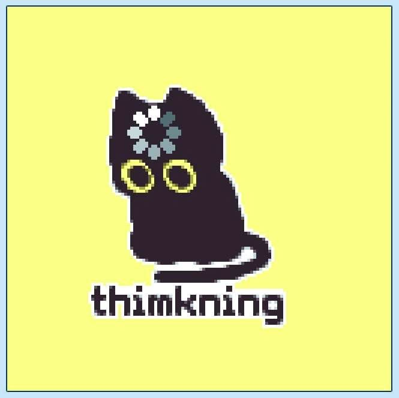

# Навигация

  

| # | Лабораторная | Материалы | Статус |
|:-:|---|---|:---:|
| 01 | **Свой Docker** | [Задание](./lab1/lab.md) · [Отчёт](./lab1/README.md) · [Файлы](./lab1/) | ✅ |
| 02 | **Наблюдаемость и мониторинг** | [Задание](./lab2/lab.md) · [Отчёт](./lab2/README.md) · [Файлы](./lab2/) | ✅ |
| 03 | **Control plane Kubernetes** | [Задание](./lab3/lab.md) · [Отчёт](./lab3/README.md) · [Файлы](./lab3/) | ✅ |
| 04 | **Ресурсы и планирование** | [Задание](./lab4/lab.md) · [Отчёт](./lab4/README.md) · [Файлы](./lab4/) | ✅ |
| 05 | **Сеть Kubernetes** | — | 🔒 |
| 06 | **Service mesh и трафик** | — | 🔒 |

## Я после первой закрытой лабы

  

## Я после двух закрытых лаб

  

## Я после трёх закрытых лаб

  

## Я после четырёх закрытых лаб

  

