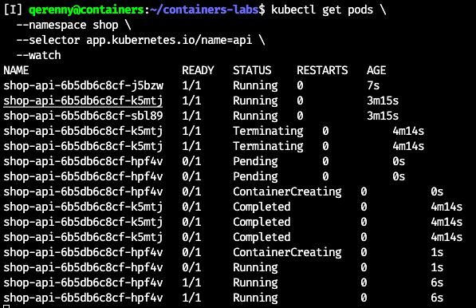
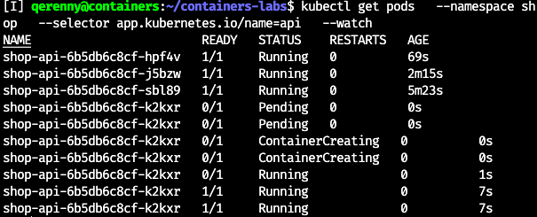
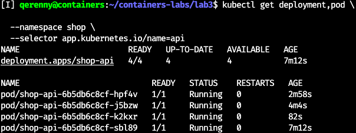
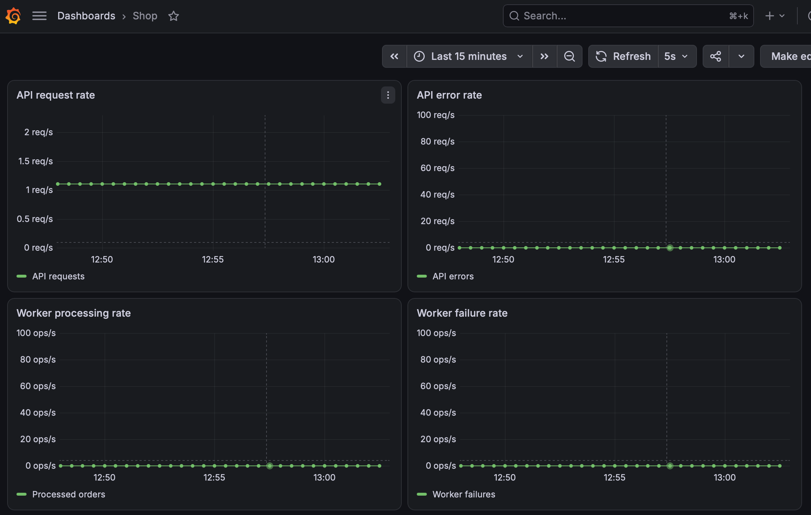
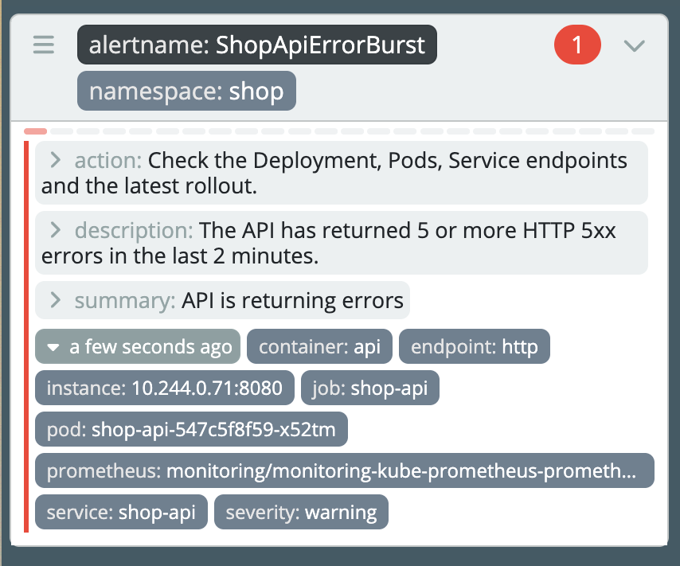

# Лаба 3

# Часть 0 -- наши подопытные

Для лабы сделал два простых сервиса: `api` принимает заказ и кладёт его в
PostgreSQL, а `worker` забирает новые заказы и помечает их обработанными.

У `api` есть:

```text
POST /order
GET  /orders
GET  /health
GET  /metrics
```

У воркера тоже есть healthcheck и метрики. Ещё оба сервиса умеют специально
ломать healthcheck через `HEALTH_FAIL=true` -- потом посмотрим, что с этим
сделает Kubernetes.

Образы собираются через multi-stage, а внутри контейнера процесс запускается
не от root, а от UID `65532`.

# Часть 1 -- поставим охранника

В этой части нужен кто-то, кто будет смотреть на манифест до его создания.
Этим кем-то будет Kyverno. Для локального kind он проще Gatekeeper: политики
остаются обычными Kubernetes-ресурсами, а проверки можно написать на CEL, не
добавляя сюда ещё и Rego.

```bash
helm upgrade --install kyverno kyverno/kyverno \
  --namespace kyverno \
  --create-namespace \
  --version 3.9.1 \
  --wait \
  --timeout 10m
```

```text
NAME: kyverno
NAMESPACE: kyverno
STATUS: deployed
Chart version: 3.9.1
Kyverno version: v1.19.1
```

Смотрим, не умерло ли что-нибудь по дороге:

```bash
kubectl get pods -n kyverno
```

```text
kyverno-admission-controller-...    1/1   Running
kyverno-background-controller-...   1/1   Running
kyverno-cleanup-controller-...      1/1   Running
kyverno-reports-controller-...      1/1   Running
```

Одна реплика admission controller -- не HA, о чём Helm честно предупредил.
Для локального kind переживём.

Ещё Helm сказал, что старые `ClusterPolicy` уже deprecated. Поэтому политики
здесь сделаны через:

```yaml
apiVersion: policies.kyverno.io/v1
kind: ValidatingPolicy
```

Для экспериментов создал отдельный namespace, чтобы не воевать со всем
кластером сразу:

```bash
kubectl apply -f policy-tests/namespace.yaml
```

Сами `ValidatingPolicy` кластерные, но системные namespaces из проверки
исключил. Иначе ошибка в собственной политике могла бы заблокировать
обновление Kyverno, мониторинга или системных компонентов.

## Первая политика, первые пострадавшие

Сначала потребовал у каждого контейнера `requests` и `limits` для CPU и
памяти.

```yaml
object.spec.containers.all(container,
  has(container.resources.requests.cpu) &&
  has(container.resources.requests.memory) &&
  has(container.resources.limits.cpu) &&
  has(container.resources.limits.memory)
)
```

`all` нужен, чтобы один приличный контейнер не прикрывал второй без
ограничений.

`requests` использует scheduler, когда решает, на какую ноду поставить Pod.
При упоре в CPU limit получаем throttling, при упоре в memory limit можно
получить `OOMKilled`.

После включения background scan Kyverno радостно пошёл проверять уже
существующие системные workloadы.

## А проверяли Pod, почему тогда Deployment тоже не пускают

Сами правила смотрят на `Pod`, а тесты сделаны через `Deployment`. Тут
срабатывает autogen:

```yaml
autogen:
  podControllers:
    controllers:
      - deployments
      - statefulsets
      - daemonsets
      - cronjobs
      - jobs
```

Kyverno берёт Pod-правило и применяет его к `spec.template` контроллера.
Поэтому Deployment не сможет сначала пройти admission, а потом наплодить
неправильные Pod'ы.

Заодно правило работает для StatefulSet, DaemonSet, Job и CronJob. У них
разное поведение, но источник Podов тот же -- шаблон внутри контроллера.

## Остальной забор

Дальше добавил ещё четыре правила.

Разрешил образы только из наших registry:

```text
registry.k8s.io/
docker.io/qerenny/
ghcr.io/cloudnative-pg/
```

Слеш на конце важен, иначе под префикс мог бы замаскироваться адрес вроде
`registry.k8s.io.lol.kek`.

Потребовал у Pod два label:

```text
app.kubernetes.io/name
app.kubernetes.io/part-of
```

Первый называет компонент, второй связывает его с приложением целиком.
У Deployment autogen ищет их уже в `spec.template.metadata.labels`.

Запретил `securityContext.privileged: true`. Если `securityContext` или само
поле `privileged` отсутствует, это нормально: по умолчанию оно равно `false`.
Так Pod не сможет получить почти неограниченный доступ к ядру и устройствам
ноды.

Ну и запретил явный `:latest`:

```yaml
!container.image.endsWith(':latest')
```

С таким тегом два одинаковых rollout могут скачать разные слои. Правда,
текущая проверка запрещает только явно написанный `:latest`. Образ вообще без
тега она пропустит, хотя runtime тоже будет считать его latest. Оставлю это
как известное ограничение политики, а не буду делать вид, что его нет.

В итоге получилось пять политик:

```text
require-resource-limits
require-trusted-registry
require-standard-labels
disallow-privileged-containers
disallow-latest-tag
```

## Попробуем пролезть

Под каждое правило сделал по одному плохому Deployment:

```text
missing-resource-limits.yaml
untrusted-registry.yaml
missing-required-labels.yaml
privileged-container.yaml
latest-image-tag.yaml
```

Проверяю через server-side dry run. Так запрос реально доходит до API server
и admission webhook, но объект не записывается в etcd.

```bash
kubectl apply \
  --dry-run=server \
  -f policy-tests/missing-resource-limits.yaml
```

```text
Error from server: admission webhook "vpol.validate.kyverno.svc-fail"
denied the request: Policy require-resource-limits failed:
Every container must define CPU and memory requests and limits.
```

Первого поймали. Остальные тоже далеко не ушли:

```text
Policy require-trusted-registry failed:
Images must come from registry.k8s.io or docker.io/qerenny.

Policy require-standard-labels failed:
Pods must define app.kubernetes.io/name and app.kubernetes.io/part-of labels.

Policy disallow-privileged-containers failed:
Privileged containers are not allowed.

Policy disallow-latest-tag failed:
Images must not use the mutable latest tag.
```

Но политика, которая запрещает вообще всё, тоже отлично прошла бы такие
тесты. Поэтому нужен нормальный Deployment, который должен выжить:

```bash
kubectl apply \
  --dry-run=server \
  -f policy-tests/compliant-workload.yaml
```

```text
deployment.apps/compliant-workload created (server dry run)
```

Вот теперь порядок: пять плохих манифестов остановились на admission, а
`compliant-workload` прошёл все политики сразу.

# Часть 2 -- завернем все это в Helm

Сделал один чарт `shop`, внутри Deployment и Service для `api` и `worker`.
Реплик по умолчанию три и две соответственно.

В шаблоны сразу положил labels, resources, нормальный registry и запрет
privileged, иначе наш же Kyverno не пустил бы чарт дальше порога.

```bash
helm template shop helm/shop |
kubectl apply --dry-run=server -f -
```

```text
service/shop-api created (server dry run)
service/shop-worker created (server dry run)
deployment.apps/shop-api created (server dry run)
deployment.apps/shop-worker created (server dry run)
```

## База внезапно нужна уже сейчас

По заданию оператор PostgreSQL будет в следующей части, но оба сервиса без
базы просто завершаются. Поэтому на время этой части поднял отдельный
одноразовый PostgreSQL с `emptyDir`. Это не финальная база и переживать смерть
Pod она не обязана.

С образом тоже немного повоевал: `kind load` споткнулся об отсутствующий blob
в multi-platform image. В итоге скачал образ сразу в containerd ноды и там же
добавил нужный тег.

```bash
docker exec lab2-control-plane \
  ctr --namespace k8s.io images pull \
  docker.io/library/postgres:16-alpine

docker exec lab2-control-plane \
  ctr --namespace k8s.io images tag \
  docker.io/library/postgres:16-alpine \
  docker.io/qerenny/lab3-postgres:16-alpine
```

PostgreSQL поднялся, Service нашёл его endpoint, после чего уже установил сам
чарт:

```bash
helm upgrade --install shop helm/shop \
  --namespace shop \
  --wait \
  --timeout 5m
```

## Убьем Pod, потому что можем

Удалил один `api` Pod руками. ReplicaSet заметил, что вместо трёх осталось два,
и сразу создал новый с другим именем.



Потом выставил четыре реплики и сделал `helm upgrade`. Сначала появился новый
Pod:



А потом Deployment догнал нужное состояние:



## Обновимся без грохота

Для API задал стратегию:

```yaml
strategy:
  type: RollingUpdate
  rollingUpdate:
    maxUnavailable: 0
    maxSurge: 1
```

Собрал `api:0.2.0`, загрузил образ в kind и поменял тег в `values.yaml`.
Обновление шло по одному Pod: сначала новый доходил до `1/1`, только потом
старый уходил в `Terminating`.

```text
shop-api-664bd6cb76-t49qd   0/1   Running       0   1s
shop-api-664bd6cb76-t49qd   1/1   Running       0   7s
shop-api-6b5db6c8cf-j5bzw   1/1   Terminating   0   9m
```

Так повторилось четыре раза. В конце старого ReplicaSet уже не осталось:

```text
NAME                        IMAGE                               READY
shop-api-664bd6cb76-dm7wc   docker.io/qerenny/lab3-api:0.2.0   true
shop-api-664bd6cb76-ktflg   docker.io/qerenny/lab3-api:0.2.0   true
shop-api-664bd6cb76-s9ggf   docker.io/qerenny/lab3-api:0.2.0   true
shop-api-664bd6cb76-t49qd   docker.io/qerenny/lab3-api:0.2.0   true
```

Сначала долбил health через `port-forward`, но он привязывается к одному Pod
и закономерно отвалился, когда именно этот Pod удалили. Сам Service при этом
не падал. Для нормальной проверки запустил цикл изнутри кластера и ходил на
`http://shop-api:8080/health` -- там всё время был `200`.

## Теперь сломаем сами

Выставил:

```yaml
api:
  healthFail: true
```

Новый Pod запустился, но `/health` отвечал `503`. Readiness не добавила его в
готовые endpoints, а liveness честно перезапускала контейнер снова и снова.

```text
deployment.apps/shop-api   4/4   1   4

replicaset.apps/shop-api-554cdd457f   1   1   0
replicaset.apps/shop-api-664bd6cb76   4   4   4

pod/shop-api-554cdd457f-8l25j   0/1   Running   3
```

Получилось: новая версия не работает, rollout стоит,
но четыре старых Pod продолжают отвечать. В цикле запросов так и остались
одни `200`.

Helm подождал свои 90 секунд и тоже признал происходящее неудачей:

```text
4   failed   Upgrade "shop" failed: resource Deployment/shop/shop-api not ready
```

Откатился на последнюю рабочую ревизию:

```bash
helm rollback shop 3 \
  --namespace shop \
  --wait \
  --timeout 5m
```

```text
Rollback was a success! Happy Helming!

5   deployed   Rollback to 3
```

Плохой Pod исчез, снова осталось четыре исправных. Сам rollback стал новой
ревизией, потому что Helm историю не переписывает.

# Часть 3 -- базе тоже нужен свой контроллер

Временный PostgreSQL из прошлой части свою задачу выполнил. Для нормального
варианта поставил CloudNativePG один раз на весь кластер.

```bash
helm upgrade --install cnpg cnpg/cloudnative-pg \
  --namespace cnpg-system \
  --create-namespace \
  --wait \
  --timeout 5m
```

```text
cnpg   cnpg-system   1   deployed   cloudnative-pg-0.29.1   1.30.1
cnpg-cloudnative-pg-7b5f5d7b65-9jk2j   1/1   Running
```

Оператор принёс с собой CRD `clusters.postgresql.cnpg.io`. В чарт добавил уже
конкретный `Cluster/shop-db`: одна инстанция, диск на 1 GiB и ресурсы, чтобы
Kyverno тоже не грустил.

```yaml
spec:
  instances: 1
  storage:
    size: 1Gi
  bootstrap:
    initdb:
      database: shop
      owner: shop
```

Helm создал CR и пошёл дальше, а оператор уже отдельно довёл базу до нужного
состояния.

```text
NAME      INSTANCES   READY   STATUS                     PRIMARY
shop-db   1           1       Cluster in healthy state   shop-db-1

pod/shop-db-1                     1/1   Running
persistentvolumeclaim/shop-db-1   Bound   1Gi
service/shop-db-rw                 ClusterIP   5432/TCP
```

CloudNativePG ещё сделал `shop-db-app` с готовой строкой подключения. Поэтому
пароль из Deployment убрал и забрал `DATABASE_URL` из Secret:

```yaml
- name: DATABASE_URL
  valueFrom:
    secretKeyRef:
      name: {{ .Release.Name }}-db-app
      key: uri
```

После обновления чарта проверил весь путь одним заказом:

```text
POST /order
{"id":1,"payload":{"item":"deadline"},"status":"pending"}

GET /orders
[{"id":1,"payload":{"item":"deadline"},"status":"processed"}]
```

Значит API записал заказ уже в новую базу, а worker его оттуда забрал. После
этого временный PostgreSQL наконец удалил.

## А если забрать у оператора Pod

Перед удалением у `shop-db-1` был такой UID:

```text
shop-db-1   283e4fb7-239c-42ec-a384-fcf97f316ce3   true
```

```bash
kubectl delete pod shop-db-1 --namespace shop
```

CloudNativePG увидел пропавшую инстанцию и создал Pod заново. Имя осталось
тем же, а UID уже другой:

```text
shop-db-1   119753fe-910e-4421-a23a-a3b4c6923490   true
```

PVC при этом никуда не делся:

```text
shop-db-1   Bound   pvc-a14d5eb4-85fc-411e-a7cc-4cbbc69b9e98   1Gi
```

Заказ после пересоздания тоже остался на месте. Данные
живут на PersistentVolume.

От обычного `kube-controller-manager` оператор отличается не какой-то новой
магией reconciliation, а знанием своей предметной области. Встроенный
контроллер понимает Deployment и ReplicaSet, а CloudNativePG понимает primary,
PostgreSQL-инстанции, подключения, PVC и объект `Cluster`.

# Часть 4 -- уберем управление API

Kind у меня однодовый, поэтому останавливать весь `lab2-control-plane` нельзя:
вместе с apiserver там живут containerd и все наши Pod. Вместо этого временно
убрал только static Pod manifest `kube-apiserver`.

Перед этим запомнил ClusterIP API и проверил его прямо из сетевого namespace
ноды:

```bash
docker exec lab2-control-plane \
  curl -sS "http://${API_IP}:8080/health"
```

Теперь убрал apiserver:

```bash
docker exec lab2-control-plane \
  mv /etc/kubernetes/manifests/kube-apiserver.yaml \
     /etc/kubernetes/disabled-manifests/
```

Kubelet не мгновенно, но заметил пропавший файл и остановил контейнер. После
этого управлять кластером уже не вышло:

```bash
kubectl get pods --namespace shop --request-timeout=5s
    context deadline exceeded - error from a previous attempt: EOF
```

Масштабирование отправилось туда же:

```bash
kubectl scale deployment/shop-api \
  --namespace shop \
  --replicas=4 \
  --request-timeout=5s

    error: context deadline exceeded - error from a previous attempt: EOF
```

Зато само приложение не заметило, что управлять им временно некому:

```bash
docker exec lab2-control-plane \
  curl -sS "http://${API_IP}:8080/health"

docker exec lab2-control-plane \
  curl -sS "http://${API_IP}:8080/orders"
```

```text
ok
[{
  "id": 1,
  "payload": {"item": "deadline"},
  "status": "processed"
}]
```

Чтобы отдельно не надеяться на старый заказ, создал ещё один уже после
отключения apiserver. Worker в этот момент тоже отвечал:

```text
GET shop-worker:8080/health
ok

POST shop-api:8080/order
{"id":2,"payload":{"item":"control-plane-down"},"status":"pending"}

GET shop-api:8080/orders
{"id":2,"payload":{"item":"control-plane-down"},"status":"processed"}
```

API смог записать новый заказ в PostgreSQL, а worker забрал его и поменял
статус. Значит без control plane продолжили работать все три компонента.

Вернул manifest обратно:

```bash
docker exec lab2-control-plane \
  mv /etc/kubernetes/disabled-manifests/kube-apiserver.yaml \
     /etc/kubernetes/manifests/kube-apiserver.yaml
```

Через несколько секунд кластер снова стал управляемым. Неудачный `scale` так
ничего и не изменил, потому что без apiserver новое значение не попало в etcd.

```text
NAME       DESIRED   READY
shop-api   3         3
```

# Часть 5 -- теперь за всем следит Prometheus

Мониторинг после второй лабы всё ещё
работает. В чарт добавил `ServiceMonitor`, который по labels находит Service
API и worker и забирает у них `/metrics`.

Сначала проверил, что он действительно нашёл все Pod:

```bash
curl --silent \
  'http://127.0.0.1:9090/api/v1/query?query=up%7Bnamespace%3D%22shop%22%7D' |
jq '.data.result[] | {
  service: .metric.service,
  pod: .metric.pod,
  up: .value[1]
}'
```

```text
shop-worker   shop-worker-84d87845c-xn5bj   1
shop-worker   shop-worker-84d87845c-pmfbh   1
shop-api      shop-api-547c5f8f59-6rtbr     1
shop-api      shop-api-547c5f8f59-x52tm     1
shop-api      shop-api-547c5f8f59-4qk9q     1
```

Все пять targets отдают `up=1`, Prometheus реально ходит на `/metrics`.

Туда же добавил dashboard `Shop`. Grafana забирает его из ConfigMap по label
`grafana_dashboard: "1"`. На нём четыре графика: запросы и ошибки API,
обработанные заказы и ошибки worker.



## Три повода поднять тревогу

`ShopApiDown` срабатывает, если у API нет ни одного живого scrape-target.
Правило учитывает оба случая: метрика существует, но равна нулю, либо вообще
пропала. Минутная задержка не даёт будить всех из-за короткого перезапуска.

`ShopApiErrorBurst` смотрит, насколько вырос счётчик ошибок за две минуты.


`ShopWorkerFailure` ловит хотя бы одну ошибку обработки за пять минут. Worker
работает в фоне, поэтому без такого alert поломку можно долго не заметить.

Правила приехали вместе с остальным чартом:

```text
service/shop-api created (server dry run)
service/shop-worker created (server dry run)
cluster.postgresql.cnpg.io/shop-db created (server dry run)
servicemonitor.monitoring.coreos.com/shop created (server dry run)

STATUS: deployed
REVISION: 10
DESCRIPTION: Upgrade complete
```

Чтобы проверить правила, поднял счётчик ошибок API. Через
заданное окно `ShopApiErrorBurst` появился в Karma в состоянии firing:



<p align="center">
  
</p>
