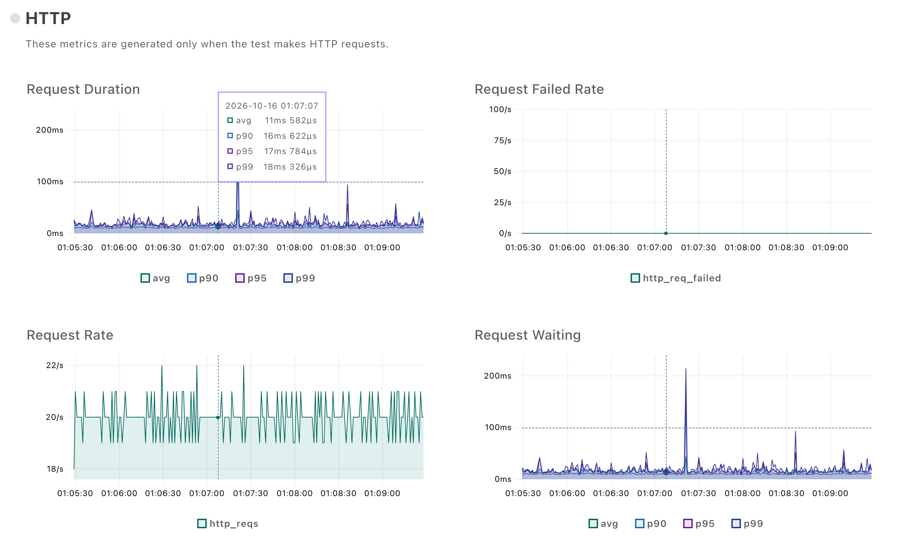
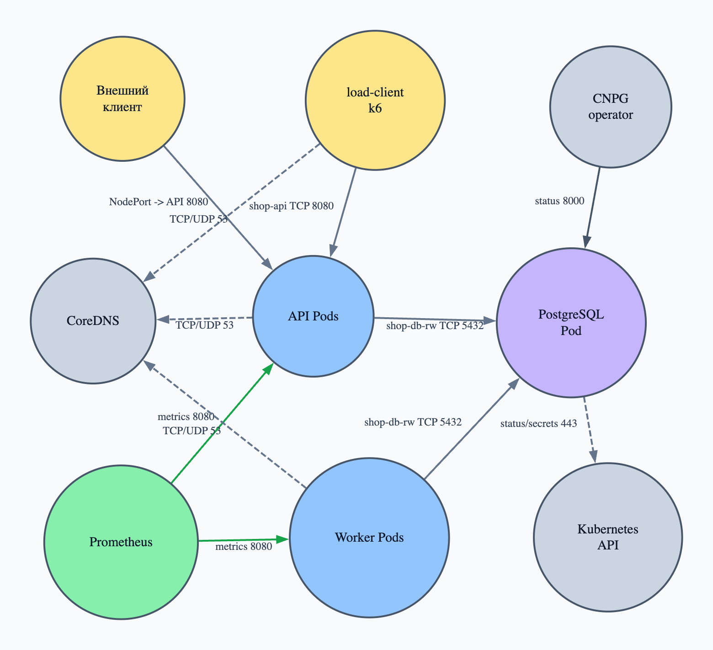
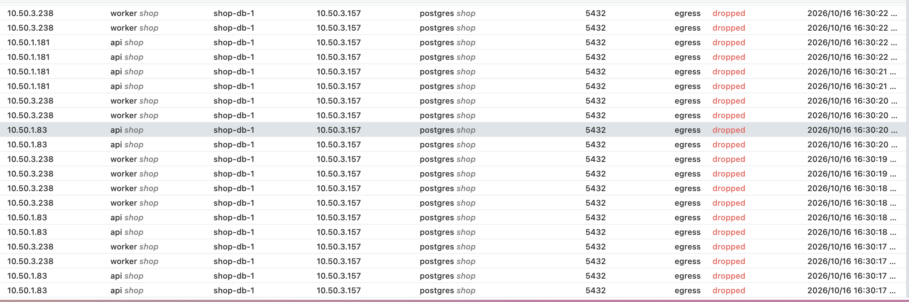
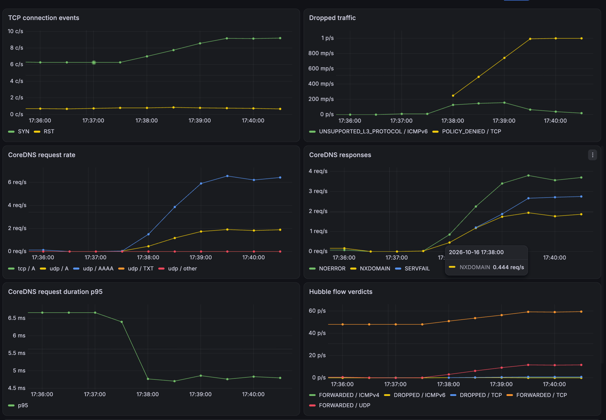
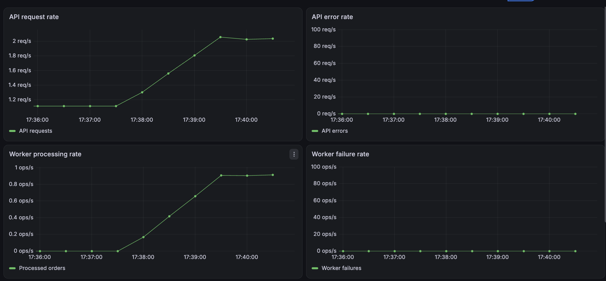
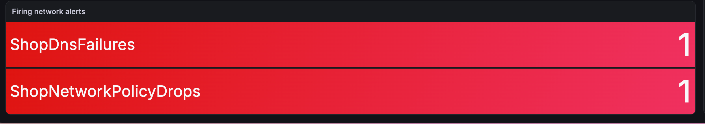

# Лаба 5

## НЕЙРОНКА: Что уже переиспользовано

- `helm/shop` — чистая копия чарта `shop` из Лабы 3. В ней уже есть `api`,
  `worker`, PostgreSQL через CloudNativePG, базовый dashboard,
  `ServiceMonitor` и `PrometheusRule`.
- Образы `docker.io/qerenny/lab3-api:0.2.0` и
  `docker.io/qerenny/lab3-worker:0.1.0` используются напрямую. Исходники
  сервисов остаются в `lab3`: программная часть в этой лабораторной не
  меняется.
- `load/order.js` перенесён из Лабы 4 как исходный генератор заказов. Его
  пороги пока относятся к SLA Лабы 4; для доказательства нулевого числа
  ошибок их предстоит адаптировать.

Чарт скопирован, а не подключён как зависимость, потому что результатом Лабы 5
должен стать самостоятельно изменяемый и сдаваемый чарт. При этом уже
закрытые лабораторные остаются неизменными.

Не переиспользуется `lab4/kind-config.yaml`: он запускает стандартный
`kindnet`, который не применяет NetworkPolicy. Конфигурация кластера зависит
от выбора Cilium или Calico и является частью работы.

Базовые `ServiceMonitor`, `PrometheusRule` и dashboard подтверждают метрики
приложения, но сами по себе не закрывают Часть 7: сетевые метрики и правила
будут зависеть от выбранного CNI.

# Часть 0 -- Выбираем CNI

Для сети взял Cilium 1.20.2. Calico тоже умеет применять NetworkPolicy, но
здесь дальше понадобится Hubble: через него можно увидеть потоки и причину
policy drop.

Стандартный `kindnet` отключаем сразу иначе API server спокойно примет
NetworkPolicy, но CNI применять её не будет и эксперимент получится немного
бессмысленным.

```yaml
# lab5/kind-config.yaml
networking:
  disableDefaultCNI: true
  podSubnet: 10.50.0.0/16
  serviceSubnet: 10.51.0.0/16
```

Поднимаем две worker-ноды, чтобы дальше действительно погонять пакет между
нодами. 
```bash
kind create cluster \
  --name lab5 \
  --config lab5/kind-config.yaml
```

До установки CNI ноды были `NotReady`, что тут как раз нормально: kubelet уже
жив, но подключить pod к сети пока некому. Ставим Cilium с VXLAN и Hubble:

```bash
helm upgrade --install cilium \
  oci://quay.io/cilium/charts/cilium \
  --version 1.20.2 \
  --namespace kube-system \
  --values lab5/cilium-values.yaml \
  --wait \
  --timeout 10m
```

Полную eBPF-замену kube-proxy пока не включал:

```yaml
kubeProxyReplacement: false
```

Так Cilium занимается сетью подов, политиками и наблюдаемостью, но обычный
`kube-proxy` остаётся в кластере — его работу с Service и NodePort ещё будем
разбирать отдельно как вроде сказано дальше в лабе.

Проверяем, что все сетевые компоненты доехали:

```bash
qerenny@containers:~/containers-labs$ kubectl -n kube-system rollout status daemonset/cilium
daemon set "cilium" successfully rolled out

qerenny@containers:~/containers-labs$ kubectl -n kube-system rollout status deployment/cilium-operator
deployment "cilium-operator" successfully rolled out

qerenny@containers:~/containers-labs$ kubectl -n kube-system rollout status deployment/hubble-relay
deployment "hubble-relay" successfully rolled out

qerenny@containers:~/containers-labs$ kubectl -n kube-system get daemonset kube-proxy
NAME         DESIRED   CURRENT   READY   UP-TO-DATE   AVAILABLE
kube-proxy   3         3         3       3            3
```

В итоге Cilium agent и kube-proxy стоят на каждой ноде, Hubble Relay готов,
все три ноды перешли в `Ready`. Можно наконец посмотреть, что Cilium там
насоздавал.

# Часть 1 -- Лезем в сеть пода

Первым делом смотрим, какие подсети Kubernetes раздал нодам:

```bash
qerenny@containers:~/containers-labs$ kubectl get nodes \
  -o custom-columns='NODE:.metadata.name,NODE_IP:.status.addresses[?(@.type=="InternalIP")].address,POD_CIDR:.spec.podCIDR'
NODE                 NODE_IP      POD_CIDR
lab5-control-plane   172.18.0.6   10.50.0.0/24
lab5-worker          172.18.0.5   10.50.1.0/24
lab5-worker2         172.18.0.7   10.50.3.0/24
```

`172.18.0.x` — адреса самих kind-нод в Docker-сети. `10.50.x.x` — уже сеть
подов. Kubernetes выдал каждой ноде свой PodCIDR `/24`, а Cilium IPAM раздаёт
подам конкретные адреса из подсети их ноды. 


В образе API, конечно же, distroless: ни shell, ни `ip`, ничего полезного для
наших раскопок. Пробуем подселить к нему `netshoot` в тот же network
namespace:

```bash
qerenny@containers:~/containers-labs$ kubectl debug -n shop \
  -it pod/shop-api-5f9ccdd865-7v9vz \
  --image=nicolaka/netshoot \
  --target=api \
  --profile=general

Warning: container debugger-jz2x9: container has runAsNonRoot and image has
non-numeric user (root), cannot verify user is non-root
```

С первого раза нас  послали: у Pod стоит `runAsNonRoot`, а у
`netshoot` пользователь записан строкой `root`.  Делаем временный профиль с явным UID и оставляем только
`NET_RAW`, который нужен для `ping`:

```yaml
# /tmp/lab5-debug-profile.yaml
securityContext:
  runAsNonRoot: true
  runAsUser: 65532
  runAsGroup: 65532
  allowPrivilegeEscalation: false
  capabilities:
    add:
      - NET_RAW
```

```bash
API_POD_NAME=$(kubectl -n shop get pods \
  -l app.kubernetes.io/name=api \
  --field-selector spec.nodeName=lab5-worker2 \
  -o jsonpath='{.items[0].metadata.name}')

kubectl debug \
  -n shop \
  -it "pod/$API_POD_NAME" \
  --image=nicolaka/netshoot \
  --target=api \
  --profile=general \
  --custom=/tmp/lab5-debug-profile.yaml \
  -- sh
```

Смотрим адрес, интерфейс и таблицу маршрутов изнутри
network namespace пода:

```bash
/root $ ip -br address show eth0
eth0@if21  UP  10.50.3.191/32  fe80::e4f9:86ff:fe27:86e9/64

/root $ ip -o link show eth0
20: eth0@if21: <BROADCAST,MULTICAST,UP,LOWER_UP> mtu 1500 ...

/root $ ip route
default via 10.50.3.161 dev eth0 mtu 1450
10.50.3.161 dev eth0 scope link
```

У пода не целая локальная подсеть, а один адрес `/32`. Всё остальное он
отправляет через gateway Cilium `10.50.3.161`, поэтому пакет обязательно
выходит через `eth0` в datapath ноды. На route MTU уже `1450`: ещё примерно
50 байт понадобятся внешним заголовкам.

Теперь ищем второй конец `eth0@if21` на ноде. Сначала я честно попытался
скормить `ip` всё отображаемое имя:

```bash
qerenny@containers:~/containers-labs$ docker exec lab5-worker2 \
  ip -d link show lxc0f409f1cd7dc@if20
Device "lxc0f409f1cd7dc@if20" does not exist.
```

`@if20` оказался не частью имени, а индексом peer-интерфейса........

```bash
qerenny@containers:~/containers-labs$ docker exec lab5-worker2 \
  ip -d link show lxc0f409f1cd7dc
21: lxc0f409f1cd7dc@if20: <BROADCAST,MULTICAST,UP,LOWER_UP> mtu 1500 ...
    link-netns cni-bde370ee-a294-56f6-13b3-8b091a0c605d
    veth ...
```

Получилась зеркальная пара.
То есть `eth0` пода и `lxc...` ноды — два конца одного veth в разных network
namespace. Именно через него пакет выходит из пода на ноду.

Проверяем связь напрямую с API-подом на другой ноде, без DNS, Service и
ClusterIP:

```bash
/root $ ping -c 3 10.50.1.38
PING 10.50.1.38 (10.50.1.38) 56(84) bytes of data.
64 bytes from 10.50.1.38: icmp_seq=1 ttl=63 time=0.519 ms
64 bytes from 10.50.1.38: icmp_seq=2 ttl=63 time=0.805 ms
64 bytes from 10.50.1.38: icmp_seq=3 ttl=63 time=0.532 ms

3 packets transmitted, 3 received, 0% packet loss
```

Для пода это обычный пакет `10.50.3.191 -> 10.50.1.38`. Ноды при этом знают
друг друга по адресам `172.18.0.7` и `172.18.0.5`, а Cilium перевозит pod
packet между ними внутри VXLAN.

```bash
qerenny@containers:~/containers-labs$ docker exec lab5-worker2 \
  ip -d link show cilium_vxlan
5: cilium_vxlan: <BROADCAST,MULTICAST,UP,LOWER_UP> mtu 1500 ...
    vxlan id 0 srcport 0 0 dstport 8472 ttl auto ageing 300 external nolearning ...
```


Напоследок смотрим endpoint Cilium для нашего IP:

```bash
CILIUM_POD_NAME=$(kubectl -n kube-system get pods \
  -l k8s-app=cilium \
  --field-selector spec.nodeName=lab5-worker2 \
  -o jsonpath='{.items[0].metadata.name}')

qerenny@containers:~/containers-labs$ kubectl -n kube-system \
  exec "$CILIUM_POD_NAME" -- cilium-dbg endpoint list | grep '10.50.3.191'
41  Disabled  Disabled  64467  gen:io.cilium.k8s.named-ports=http.TCP.8080  10.50.3.191  ready
```

Оба `Disabled` означают, что ingress- и egress-policy enforcement пока не
включены: ни одной NetworkPolicy у нас ещё нет. Потом сравним этот вывод с
default-deny.

В сухом остатке пакет прошёл такой путь: из eth0 первого Pod он попал в парный lxc/veth-интерфейс на ноде lab5-worker2, затем прошёл через eBPF datapath Cilium. После этого пакет был инкапсулирован в VXLAN и передан по Docker-сети kind на ноду lab5-worker. Там он снова прошёл через eBPF datapath Cilium, затем через veth второго Pod и в итоге попал в его eth0.
## Часть 2 — непрерывность через Service

Сначала выставил API наружу через `NodePort`. Внутри кластера у сервиса всё
так же остаётся `ClusterIP`, просто в дополнение к нему kube-proxy открывает
один и тот же порт на каждой ноде:

```yaml
# lab5/helm/shop/values.yaml
api:
  service:
    type: NodePort
    port: 8080
    nodePort: 30080
```

В kind порт `30080` control-plane ноды проброшен на `18080` хоста. Проверяю
внешнюю точку входа:

```bash
qerenny@containers:~/containers-labs$ curl -v http://127.0.0.1:18080/health
> GET /health HTTP/1.1
< HTTP/1.1 200 OK

ok

qerenny@containers:~/containers-labs$ kubectl -n shop get service shop-api
NAME       TYPE       CLUSTER-IP     EXTERNAL-IP   PORT(S)
shop-api   NodePort   10.51.137.78   <none>        8080:30080/TCP
```

`NodePort` подходит для этой лабы, потому что внешний балансировщик мне в
локальном kind не нужен. `LoadBalancer` попросил бы отдельный контроллер
создать внешний балансировщик, которого тут нет. У headless-сервиса вообще
не было бы виртуального IP. Здесь нужен обратный эффект — один стабильный адрес,
за которым поды могут постоянно меняться.

Изнутри кластера клиент ходит не через NodePort, а по имени `shop-api`:

```bash
qerenny@containers:~/containers-labs$ kubectl run http-check \
  --namespace shop \
  --image=curlimages/curl \
  --restart=Never \
  --rm -it -- curl -v http://shop-api:8080/health

* Host shop-api:8080 was resolved.
* IPv4: 10.51.137.78
* Established connection to shop-api (10.51.137.78 port 8080)
< HTTP/1.1 200 OK

ok
```

То есть CoreDNS превратил короткое имя в
`shop-api.shop.svc.cluster.local` и вернул стабильный ClusterIP
`10.51.137.78`. Адреса подов DNS здесь вообще не интересуют.

### Нагрузка и непрерывный хаос

В `load/order.js` поставил  пороги: не допускается ни одного
неуспешного HTTP-запроса и ни одной проваленной проверки. Pod с k6 делает
20 `POST /order` в секунду в течение четырёх минут:

```javascript
'http_req_failed{endpoint:order}': ['rate==0'],
'checks{endpoint:order}': ['rate==1'],
```

Параллельно `scripts/chaos-pods.sh` каждые пять секунд выбирает случайный
`api` или `worker` и удаляет его с `--wait=false`.

Первый запуск с обычным завершением Pod оказался неидеальным:

```text
✗ order created
 ↳  99% — ✓ 4789 / ✗ 12

checks.................: 99.75% 4789 out of 4801
http_req_failed........: 0.24%  12 out of 4801
http_req_duration......: p(95)=21.21ms
```

При этом в логе хаоса у API всегда оставалось минимум два ready endpoint.
Добавлять ещё реплики поэтому бессмысленно.


Service выбирает backend только для нового соединения. После DNAT запись
 продолжает отправлять пакеты этого TCP-соединения в тот же Pod.
Если kubelet уже послал процессу `SIGTERM`, то отправленый пакет никто не отменит. Отсюда и редкие обрывы на фоне
нормального p95.

Чтобы не винить приложение во всех бедах, отдельно прогнал те же четыре минуты вообще
без chaos:

```text
checks.................: 100.00% 4801 out of 4801
http_req_failed........: 0.00%   0 out of 4801
http_req_duration......: p(95)=17.9ms
```

Baseline чистый, поэтому исправил именно завершение API. Образ distroless,
так что `exec: sleep 5` внутри него не сработал бы — там нет shell и утилиты
`sleep`. Вместо этого использовал lifecycle sleep-handler, который выполняет
сам kubelet:



На контрольном графике нагрузка держится около 20 запросов в секунду, а
`Request Failed Rate` всё время остаётся на нуле.

```yaml
terminationGracePeriodSeconds: 20

lifecycle:
  preStop:
    sleep:
      seconds: 5
```

При удалении endpoint становится terminating и перестаёт выбираться для
новых соединений, но сам API ещё пять секунд продолжает обслуживать старые.
После `preStop` kubelet отправляет `SIGTERM`, а Go-сервис уже сам вызывает
`http.Server.Shutdown()` с timeout 10 секунд. Поэтому общий grace period
сделан 20 секунд: пять на распространение состояния сети, десять на
shutdown и ещё небольшой запас.

Во втором запуске за четыре минуты скрипт удалил 38 подов: 26 API и 12
worker. Готовых API и endpoint при этом было не меньше двух. Полный журнал:
[`reports/chaos-graceful.log`](reports/chaos-graceful.log).

```text
Starting pod chaos in namespace=shop for 240s, interval=5s
2026-10-15T22:20:59+00:00 deleting pod=shop-api-59bf89865c-4xxqs
component=api ip=10.50.3.168 ready=api:3,worker:2
api_endpoints=[10.50.1.184 10.50.3.168 10.50.1.219]
...
Pod chaos finished
```

И на этот раз k6 не потерял ни одного запроса:

```text
✓ order created

checks.........................: 100.00% 4800 out of 4800
http_req_failed................: 0.00%   0 out of 4800
http_req_duration..............: p(95)=24.47ms
http_reqs......................: 4800    19.999908/s
```

Графики всего четырёхминутного интервала лежат в
[`reports/k6-chaos-graceful.html`](reports/k6-chaos-graceful.html). На них
видно постоянные 20 запросов в секунду и нулевой `http_req_failed` всё время,
пока в соседнем логе непрерывно меняются имена и IP подов.

### Кто что делал в сетевом стеке

- CoreDNS возвращал клиенту стабильный ClusterIP.
- Service задавал виртуальную точку входа и selector для API.
- Контроллер EndpointSlice следил за подходящими Pod и обновлял их IP и
  состояния `ready`/`terminating`.
- kube-proxy смотрел на Service и EndpointSlice и программировал на нодах
  правила DNAT.
- conntrack запоминал выбранный backend на время существования соединения.
- Deployment видел удаление Pod и создавал замену, а Cilium выдавал ей новый
  IP и подключал к pod-сети.

Проверил фактический режим kube-proxy:

```bash
qerenny@containers:~/containers-labs$ kubectl -n kube-system get configmap kube-proxy \
  -o jsonpath='{.data.config\.conf}' | grep -E '^mode:|^[[:space:]]+mode:'
mode: iptables

qerenny@containers:~/containers-labs$ kubectl -n kube-system logs daemonset/kube-proxy \
  --tail=200 | grep -Ei 'proxier|iptables|ipvs'
I1013 19:46:23.333424 1 server_linux.go:137] "Using iptables Proxier"
```

В моём масштабе разницу между iptables и IPVS по производительности увидеть
практически негде: сервисов мало, endpoint у API всего три. Она становится
заметнее в больших кластерах с тысячами endpoint и частыми
изменениями. В iptables backend выбирается цепочками правил по очереди, а IPVS хранит
виртуальные сервисы и backend в собственных таблицах и имеет отдельные
алгоритмы планирования.

## Часть 3 — целевая матрица доступа

По исходникам оба сервиса работают независимо:
API записывает заказы в PostgreSQL, а worker забирает их оттуда же.

В строках матрицы находятся источники, в столбцах — назначения. `ALLOW`
означает явно нужный маршрут, `DENY` — запрещённый поток через policy boundary
namespace `shop`, а `—` — трафик вне области действия этих политик:

| Источник \ Назначение | API 8080 | Worker 8080 | PostgreSQL 5432 | PG manager 8000 | CoreDNS 53 TCP/UDP | Kube API 443 | Интернет |
|---|:---:|:---:|:---:|:---:|:---:|:---:|:---:|
| внешний клиент | **ALLOW** | DENY | DENY | DENY | — | — | — |
| `load-client` (k6) | **ALLOW** | DENY | DENY | DENY | **ALLOW** | DENY | DENY |
| Prometheus | **ALLOW** | **ALLOW** | DENY | DENY | — | — | — |
| API | DENY | DENY | **ALLOW** | DENY | **ALLOW** | DENY | DENY |
| Worker | DENY | DENY | **ALLOW** | DENY | **ALLOW** | DENY | DENY |
| CNPG operator | DENY | DENY | DENY | **ALLOW** | — | — | — |
| PostgreSQL instance | DENY | DENY | — | — | DENY | **ALLOW** | DENY |
| посторонний Pod в `shop` | DENY | DENY | DENY | DENY | DENY | DENY | DENY |

Граф разрешённых потоков из этой матрицы:



Это именно схема запроектированных разрешений. Фактический результат ниже
фиксирую отдельной зелёной матрицей: сам по себе граф не доказывает, что
политики действительно пропускают и блокируют пакеты.

`shop-db-rw` — это Service primary-инстанса CloudNativePG. В правилах дальше
нужно выбирать не Service по имени, а конечные PostgreSQL Pod по меткам:
NetworkPolicy работает с endpoint, до которого дошёл трафик после выбора
Service.

DNS вынесен отдельно и ограничен CoreDNS, а не всем `kube-system`. Нужны оба
протокола: обычный запрос чаще идёт по UDP, но TCP используется, например,
если ответ обрезан или слишком большой.

Проверки kubelet в эту прикладную матрицу не добавлял. Это трафик ноды к
своему Pod, а не разрешение одному workload ходить в другой. Зато мониторинг
добавил явно: после default-deny приложение могло бы продолжить работать,
но Prometheus потерял бы targets и мы получили бы уже другую скрытую
поломку.

У PostgreSQL есть ещё два служебных маршрута CloudNativePG. Оператор должен
достучаться до instance manager на `8000`, а instance manager — до
Kubernetes API, без него оператор
теряет состояние инстанса и не может нормально им управлять. Этот трафик
явно указан в документации CloudNativePG, поэтому его тоже нужно учитывать.


## Часть 4 — zero-trust

Первой политикой выбрал вообще все Pod в
`shop` и включил для них ingress- и egress-изоляцию. Пустых разрешений у неё
нет, поэтому это и есть общая точка `default-deny`:

```yaml
spec:
  podSelector: {}
  policyTypes:
    - Ingress
    - Egress
```

Дальше сделал отдельные разрешения для DNS, API, worker, PostgreSQL,
Prometheus и нагрузочного клиента. Получилось семь обычных
`NetworkPolicy`: одна всё закрывает, остальные возвращают маршруты из
матрицы.

Перед применением отрендерил шаблон и проверил чарт:

```bash
qerenny@containers:~/containers-labs$ helm lint lab5/helm/shop
==> Linting lab5/helm/shop
[INFO] Chart.yaml: icon is recommended

1 chart(s) linted, 0 chart(s) failed

qerenny@containers:~/containers-labs$ helm template shop lab5/helm/shop \
  --namespace shop \
  --show-only templates/network-policies.yaml
```

После этого обновил release и убедился, что политики действительно появились
в namespace:

```bash
qerenny@containers:~/containers-labs$ helm upgrade --install shop \
  lab5/helm/shop \
  --namespace shop
Release "shop" has been upgraded. Happy Helming!
STATUS: deployed

qerenny@containers:~/containers-labs$ kubectl -n shop get networkpolicy
NAME                            POD-SELECTOR
shop-allow-api-ingress          app.kubernetes.io/name=api,app.kubernetes.io/part-of=shop
shop-allow-app-egress           app.kubernetes.io/name in (api,worker),app.kubernetes.io/part-of=shop
shop-allow-dns-egress           app.kubernetes.io/name in (api,load-client,worker),app.kubernetes.io/part-of=shop
shop-allow-load-client-egress   app.kubernetes.io/name=load-client,app.kubernetes.io/part-of=shop
shop-allow-postgres             app.kubernetes.io/name=postgres,app.kubernetes.io/part-of=shop
shop-allow-worker-monitoring    app.kubernetes.io/name=worker,app.kubernetes.io/part-of=shop
shop-default-deny               <none>
```

Сначала проверил разрешённый маршрут изнутри. Тестовый Pod получил те же
labels, которые разрешены для `load-client`, иначе его тоже закономерно
отрезал бы `default-deny`:

```bash
qerenny@containers:~/containers-labs$ kubectl run allowed-check \
  --namespace shop \
  --image=curlimages/curl \
  --labels='app.kubernetes.io/name=load-client,app.kubernetes.io/part-of=shop' \
  --restart=Never --rm -it -- sh -c '
    curl -sv http://shop-api:8080/health &&
    curl -sv -H "Content-Type: application/json" \
      -d "{\"source\":\"network-policy-check\"}" \
      http://shop-api:8080/order
  '
* Host shop-api:8080 was resolved.
* IPv4: 10.51.137.78
< HTTP/1.1 200 OK
ok
< HTTP/1.1 201 Created
{"id":16276,"payload":{"source":"network-policy-check"},"status":"pending"}
```

Здесь одним тестом прошёл почти весь прикладной путь: k6-под сходил в
CoreDNS, получил ClusterIP, дошёл до API, а API записал заказ в PostgreSQL.

А вот внешний NodePort сразу сломался. `curl` подключался к локальному порту,
но HTTP-ответ так и не приходил:

```bash
qerenny@containers:~/containers-labs$ curl --max-time 5 -v \
  http://127.0.0.1:18080/health
* Connected to 127.0.0.1 port 18080
> GET /health HTTP/1.1
* Operation timed out after 5003 milliseconds with 0 bytes received
curl: (28) Operation timed out
```

`Connected` здесь немного наеб***: соединение принял проброс порта
Docker, но это ещё не означало, что SYN дошёл до API Pod. Запустил
`cilium-dbg monitor --type drop` сразу на всех трёх нодах и параллельно
повторил curl. В drop нашёлся реальный пакет:

```text
drop (Policy denied) identity world->64467:
10.50.0.19:41138 -> 10.50.1.181:8080 tcp SYN
```

Изначально я разрешил через `ipBlock` Docker-сеть нод `172.18.0.0/16`, но
после Docker port mapping, NodePort и kube-proxy Cilium видел уже источник
`10.50.0.19` и порт Pod `8080`. Поменял CIDR на `10.50.0.0/24`, но трафик
всё равно продолжал падать: у пакета была специальная identity `world`, а не
обычная CIDR identity.

В том же захвате неожиданно нашёл ещё один постоянный отказ:

```text
drop (Policy denied) identity 4789->kube-apiserver:
10.50.3.157:42044 -> 172.18.0.6:6443 tcp SYN
```

Это PostgreSQL instance manager пытался обратиться к Kubernetes API. В
первом варианте я разрешил адрес Service `10.51.0.1:443`, которым пользуется
клиент. Но в точке проверки policy kube-proxy уже сделал DNAT и Cilium видел
реальный API server на `172.18.0.6:6443`.

Попробовал оставить стандартные `ipBlock`: поставил фактический адрес API,
временно включил в Cilium `policyCIDRMatchMode: nodes`, обновил Cilium и
повторно импортировал политики. Проверка настройки прошла:

```bash
qerenny@containers:~/containers-labs$ kubectl -n kube-system get configmap cilium-config \
  -o jsonpath='{.data.policy-cidr-match-mode}{"\n"}'
nodes
```

Но повторный monitor показал те же отказы. То есть проблема была уже Cilium классифицировал обе стороны специальными
identities.


В итоге обычные Pod-связи оставил стандартными `NetworkPolicy`, а эти две
Cilium-специфичные связи описал через `CiliumNetworkPolicy`:

```yaml
# внешний клиент -> API:8080
ingress:
  - fromEntities:
      - world
    toPorts:
      - ports:
          - port: "8080"
            protocol: TCP

# PostgreSQL instance manager -> kube-apiserver:6443
egress:
  - toEntities:
      - kube-apiserver
    toPorts:
      - ports:
          - port: "6443"
            protocol: TCP
```


Снова прогнал lint, посмотрел итоговый render и обновил release. Теперь в
чарте семь стандартных политик и две Cilium-политики:

```bash
qerenny@containers:~/containers-labs$ kubectl -n shop get ciliumnetworkpolicy
NAME                           AGE   VALID
shop-allow-external-api        2s    True
shop-allow-postgres-kube-api   2s    True
```

`VALID=True` доказывает только то, что Cilium понял конфигурацию, поэтому
финально снова проверил реальный трафик и одновременно слушал policy drops:

```bash
qerenny@containers:~/containers-labs$ curl --max-time 5 -v \
  http://127.0.0.1:18080/health
< HTTP/1.1 200 OK
< Content-Length: 3

ok

qerenny@containers:~/containers-labs$ kubectl -n shop get cluster shop-db
NAME      INSTANCES   READY   STATUS                     PRIMARY
shop-db   1           1       Cluster in healthy state   shop-db-1
```

В этот раз `grep` по monitor-логам не нашёл прежних drop на `8080` и
`6443`: NodePort реально дошёл до API, а instance manager перестал биться в
закрытый kube-apiserver.


## Часть 5 — фактическая матрица доступа

После применения политик прошёл матрицу реальными сетевыми запросами. Для
проверки использовал не имена Service, а конкретные IP и порты назначений —
так DNS не мог замаскировать результат TCP-проверки:

```text
api-peer       10.50.3.153:8080
worker-peer    10.50.1.91:8080
postgres       10.50.3.157:5432
pg-manager     10.50.3.157:8000
dns            10.51.0.10:53
kube-api       10.51.0.1:443
```

Источниками были Pod API, worker, PostgreSQL, Prometheus и CNPG
operator. В них временно добавлял debug-контейнер `nicolaka/netshoot` и из
него отдельно проверял каждый адрес через `nc` или `dig`. Для `load-client` и
постороннего клиента поднял временные Pod: первый получил разрешённые
политикой labels, второй остался без них.

Например, строку API проверял из network namespace самого API Pod:

```bash
qerenny@containers:~/containers-labs$ kubectl debug -n shop \
  --attach=true "pod/$API_POD_NAME" \
  --image=nicolaka/netshoot \
  --target=api \
  --profile=general \
  --custom=/tmp/lab5-debug-profile.yaml \
  -- sh

/ # nc -zvw2 10.50.3.153 8080
/ # nc -zvw2 10.50.3.157 5432
/ # nc -zvw2 10.50.3.157 8000
/ # dig +notcp +time=2 +tries=1 @10.51.0.10 shop-api.shop.svc.cluster.local A
/ # dig +tcp +time=2 +tries=1 @10.51.0.10 shop-api.shop.svc.cluster.local A
/ # nc -zvw2 10.51.0.1 443
```

Для DNS использовал настоящий запрос отдельно по UDP и TCP. Обычный
`nc -u` здесь был бы слабым доказательством: UDP не устанавливает соединение
и успешный exit code ещё не гарантирует, что CoreDNS вернул ответ.

Для проверки `API → API` взял IP **другой** реплики. Если обратиться через
Service и kube-proxy выберет исходный Pod, получится соединение Pod с самим
собой. NetworkPolicy не может запретить Pod доступ к самому себе, поэтому
такой тест дал бы ложный `ALLOW`.

Внешний путь проверил через NodePort, а посторонний Pod создал без
разрешающих labels:

```bash
qerenny@containers:~/containers-labs$ curl --max-time 3 \
  http://127.0.0.1:18080/health
ok

qerenny@containers:~/containers-labs$ kubectl run matrix-outsider \
  --namespace shop \
  --image=nicolaka/netshoot \
  --restart=Never -- sleep 3600
```

Для TCP-проверок использовал timeout в две секунды. Успешное соединение
считал `ALLOW`, а timeout — `DENY`. Ответ `connection refused` нельзя считать
блокировкой NetworkPolicy: он означает, что пакет дошёл до назначения, но на
указанном порту никто не слушает. Здесь проверяемые порты были открыты
соответствующими процессами, поэтому такого неоднозначного результата не
возникло.

Результаты всех отдельных проб свёл в одну таблицу. В каждой ячейке слева
указан ожидаемый результат, справа — фактический. `—` означает, что проверка
не имеет смысла в границах политик `shop`.

| Источник \ Назначение | API 8080 | Worker 8080 | PostgreSQL 5432 | PG manager 8000 | CoreDNS 53 TCP/UDP | Kube API 443 | Интернет |
|---|:---:|:---:|:---:|:---:|:---:|:---:|:---:|
| внешний клиент | ALLOW / ALLOW ✅ | — | — | — | — | — | — |
| `load-client` | ALLOW / ALLOW ✅ | DENY / DENY ✅ | DENY / DENY ✅ | DENY / DENY ✅ | ALLOW / ALLOW ✅ | DENY / DENY ✅ | DENY / DENY ✅ |
| Prometheus | ALLOW / ALLOW ✅ | ALLOW / ALLOW ✅ | DENY / DENY ✅ | DENY / DENY ✅ | — | — | — |
| API | DENY / DENY ✅ | DENY / DENY ✅ | ALLOW / ALLOW ✅ | DENY / DENY ✅ | ALLOW / ALLOW ✅ | DENY / DENY ✅ | DENY / DENY ✅ |
| Worker | DENY / DENY ✅ | DENY / DENY ✅ | ALLOW / ALLOW ✅ | DENY / DENY ✅ | ALLOW / ALLOW ✅ | DENY / DENY ✅ | DENY / DENY ✅ |
| CNPG operator | DENY / DENY ✅ | DENY / DENY ✅ | DENY / DENY ✅ | ALLOW / ALLOW ✅ | — | — | — |
| PostgreSQL instance | DENY / DENY ✅ | DENY / DENY ✅ | — | — | DENY / DENY ✅ | ALLOW / ALLOW ✅ | DENY / DENY ✅ |
| посторонний Pod в `shop` | DENY / DENY ✅ | DENY / DENY ✅ | DENY / DENY ✅ | DENY / DENY ✅ | DENY / DENY ✅ | DENY / DENY ✅ | DENY / DENY ✅ |

У двух строк есть важные нюансы. PostgreSQL и его instance manager работают
в одном Pod и делят один network namespace, поэтому проверки
`PostgreSQL → PostgreSQL` и `PostgreSQL → PG manager`  вернули
`ALLOW`.

У Prometheus и CNPG operator также получились `ALLOW` к DNS, Kubernetes API
и интернету. Эти Pod находятся в namespace `monitoring` и `cnpg-system`, а
наши egress-политики выбирают только Pod в `shop`. Поэтому результаты не
доказывают и не опровергают матрицу `shop` и тоже отмечены прочерками.

Ключевые проверки задания сошлись: посторонний Pod не подключился к
PostgreSQL, а API и worker подключились. При этом разрешение не получилось
широким: `load-client` дошёл только до API и DNS, Prometheus — только до
метрик API и worker, а CNPG operator — только до instance manager.

DNS дополнительно перепроверил настоящим запросом `dig`, отдельно по UDP и
TCP. В первой версии проверки я определял успех по непустому stdout. Это
оказалось ошибкой: при timeout `dig` тоже печатает туда диагностический
текст, поэтому запрещённый запрос ошибочно отображался как `ALLOW`. После
исправления проверка принимала за успех только строку с IP-адресом из
DNS-ответа. Получился ожидаемый результат:

```text
=== api ===
UDP      ALLOW  10.51.137.78
TCP      ALLOW  10.51.137.78

=== worker ===
UDP      ALLOW  10.51.137.78
TCP      ALLOW  10.51.137.78

=== postgres ===
UDP      DENY
TCP      DENY

=== load-client ===
UDP      ALLOW  10.51.137.78
TCP      ALLOW  10.51.137.78

=== outsider ===
UDP      DENY
TCP      DENY
```

Таким образом, DNS разрешён не всему namespace, а только API, worker и
нагрузочному клиенту. PostgreSQL и посторонний Pod выбраны общим
`default-deny`, но не подходят под selector разрешающей DNS-политики, поэтому
оба протокола у них блокируются.


## Часть 6 — диагностика скрытой поломки

Чтобы не искать заранее известную ошибку, попросил AI изменить один из
параметров сетевых политик и не сообщать, какой именно. После этого применил
чарт, не просматривая diff:

```bash
qerenny@containers:~/containers-labs$ helm upgrade --install shop \
  lab5/helm/shop \
  --namespace shop
Release "shop" has been upgraded. Happy Helming!
STATUS: deployed
```

Helm успешно применил release, а Kubernetes принял все политики. При создании
заказа TCP-соединение с NodePort устанавливалось, но API сбрасывал его без
HTTP-ответа:

```bash
qerenny@containers:~/containers-labs$ curl --max-time 5 -sv \
  -H 'Content-Type: application/json' \
  -d '{"source":"part-6","number":1}' \
  http://127.0.0.1:18080/order
* Connected to 127.0.0.1 port 18080
> POST /order HTTP/1.1
* Recv failure: Connection reset by peer
```

Одинаковая ошибка появилась во всех репликах API и worker:

```text
[shop-api/api]       initialise database: context deadline exceeded
[shop-worker/worker] initialise database: context deadline exceeded
```

Значит, внешний ingress до API не был основной проблемой: ломалась общая
зависимость двух приложений. Открыл Hubble UI, отфильтровал `namespace=shop` и
`verdict=dropped`, затем воспроизвёл запрос ещё раз. Hubble показал
конкретный отброшенный SYN:




```text
Timestamp:         2026-10-16T13:30:20.490Z
Verdict:           dropped
Drop reason:       Policy denied
Traffic direction: egress
TCP flags:         SYN

Source:      shop-worker-f8bf75c4-4m5q2 (10.50.3.238)
Destination: shop-db-1                    (10.50.3.157)
Port:        5432/TCP
```

Здесь DNS уже не участвовал: Hubble видел конечный IP PostgreSQL. SYN был
отброшен до TCP handshake, поэтому PostgreSQL даже не получил соединение.
`egress` в событии означает направление относительно worker, а не
отсутствие ingress-проверки на стороне PostgreSQL.

После этого сравнил реальный порт потока с обеими применёнными политиками:

```bash
qerenny@containers:~/containers-labs$ kubectl -n shop get networkpolicy \
  shop-allow-app-egress \
  -o jsonpath='{.spec.egress[0].ports[0].port}{"\n"}'
5433

qerenny@containers:~/containers-labs$ kubectl -n shop get networkpolicy \
  shop-allow-postgres \
  -o jsonpath='{.spec.ingress[0].ports[0].port}{"\n"}'
5433
```

Причиной оказался неверный `postgres.port` в `values.yaml`. Один параметр
использовался в двух местах шаблона: в egress API/worker и в ingress
PostgreSQL. Поэтому значение `5433` одновременно закрыло обе стороны
фактического соединения на `5432`. Вернул правильное значение и снова
применил release.


После исправления три контрольных запроса снова создали заказы:

```text
{"id":16277,"payload":{"source":"part-6-fixed","number":1},"status":"pending"}
{"id":16278,"payload":{"source":"part-6-fixed","number":2},"status":"pending"}
{"id":16279,"payload":{"source":"part-6-fixed","number":3},"status":"pending"}
```

После исправления CloudNativePG остался в состоянии `healthy`, а в свежих
логах API и worker больше не появлялось `context deadline exceeded`.
Отрицательную часть матрицы тоже перепроверил: посторонний Pod по-прежнему
не смог подключиться к PostgreSQL:

```text
NAME      INSTANCES   READY   STATUS                     PRIMARY
shop-db   1           1       Cluster in healthy state   shop-db-1

nc: connect to 10.50.3.157 port 5432 timed out
PASS: outsider cannot reach PostgreSQL
```

В итоге разрешённый маршрут `API/worker → PostgreSQL:5432` восстановился,
три контрольных заказа записались в базу, а запрещённый маршрут
`outsider → PostgreSQL:5432` остался закрыт. Поломка устранена без расширения
исходной zero-trust матрицы.

## Часть 7 — мониторинг

Новый Prometheus поднимать не стал: переиспользовал
`kube-prometheus-stack` из Лабы 2. Его selectors уже разрешают находить
`ServiceMonitor` и `PrometheusRule` во всех namespace. При этом Hubble и
Cilium экспортировали метрики, но Prometheus ещё не знал, откуда их
забирать. Поэтому в `cilium-values.yaml` включил штатные ServiceMonitor
Cilium chart:

```yaml
hubble:
  metrics:
    serviceMonitor:
      enabled: true

prometheus:
  enabled: true
  serviceMonitor:
    enabled: true
```

После обновления Cilium проверил не только наличие CR, но и реальные scrape
targets в Prometheus:

```text
up  cilium-agent    http://172.18.0.5:9962/metrics
up  cilium-agent    http://172.18.0.6:9962/metrics
up  cilium-agent    http://172.18.0.7:9962/metrics
up  hubble-metrics  http://172.18.0.5:9965/metrics
up  hubble-metrics  http://172.18.0.6:9965/metrics
up  hubble-metrics  http://172.18.0.7:9965/metrics
up  coredns         http://10.50.1.125:9153/metrics
up  coredns         http://10.50.1.175:9153/metrics
```

Для dashboard использовал фактически найденные series, а не предполагаемые
названия из документации:

| Что наблюдаю | Метрика | Что показываю |
|---|---|---|
| TCP-соединения | `hubble_tcp_flags_total` | скорость SYN и RST |
| Решение datapath | `hubble_flows_processed_total` | потоки по verdict и protocol |
| Отброшенный трафик | `hubble_drop_total` | drops по reason и protocol |
| Запросы DNS | `coredns_dns_requests_total` | скорость по TCP/UDP и типу записи |
| Ответы DNS | `coredns_dns_responses_total` | скорость по response code |
| Задержка DNS | `coredns_dns_request_duration_seconds_bucket` | p95 обработки запроса |

В Hubble metrics сейчас нет source/destination workload labels: series
агрегированы на уровне Cilium agent. Это удерживает cardinality, а конкретные
Pod и порт при расследовании по-прежнему смотрю в Hubble UI, как в Части 6.

В существующий dashboard добавил шесть сетевых панелей. На тестовой нагрузке
видны рост SYN, `POLICY_DENIED`, DNS-запросы и ответы, latency CoreDNS и
соотношение forwarded/dropped flows:



При этом прикладные панели подтверждают, что разрешённая нагрузка продолжала
создавать и обрабатывать заказы без ошибок:



В `PrometheusRule` добавил три сетевых алерта, а окна, выдержки и пороги
вынес в `values.yaml`:

| Алерт | Условие | Зачем нужен |
|---|---|---|
| `ShopNetworkPolicyDrops` | больше 5 `POLICY_DENIED` за 2 минуты | замечает устойчивый запрещённый поток, но не шумит от единственного probe |
| `ShopTcpResetBurst` | больше 1 RST/с в течение минуты | ловит ситуацию, когда маршрут доступен, но соединения массово сбрасываются endpoint'ами |
| `ShopDnsFailures` | больше 5 `SERVFAIL`/`REFUSED` за 2 минуты либо CoreDNS target недоступен | DNS является общей зависимостью всех обращений к Service по имени |

Для проверки создал два временных Pod. `dashboard-load` имел labels
разрешённого `load-client`, постоянно резолвил `shop-api` и создавал заказы.
`dashboard-outsider` без разрешающих labels пытался подключиться напрямую к
PostgreSQL и генерировал контролируемые policy drops. После выдержки
Prometheus перевёл алерт в `firing`.

На том же интервале появился реальный поток ответов CoreDNS с `SERVFAIL`,
поэтому сработал и DNS-алерт. Значение `1` на stat-панели означает активную
alert series, а не один отброшенный пакет:



После снимка временные Pod удалил. Таким образом, проверена вся цепочка:
exporter Cilium/CoreDNS → ServiceMonitor → Prometheus → PrometheusRule и
Grafana. Алерты не просто существуют в Kubernetes API — два из трёх правил
дошли до состояния `firing` на реальных метриках.

<p align="center">
  
</p>
